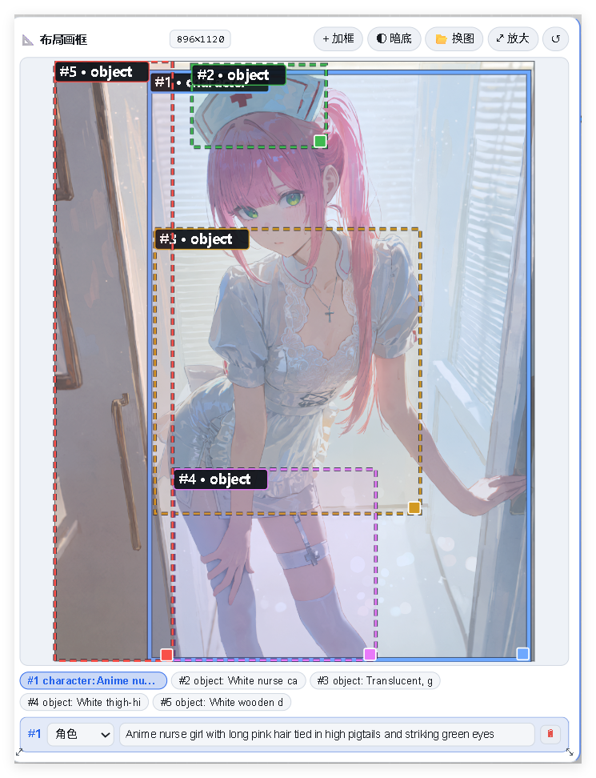
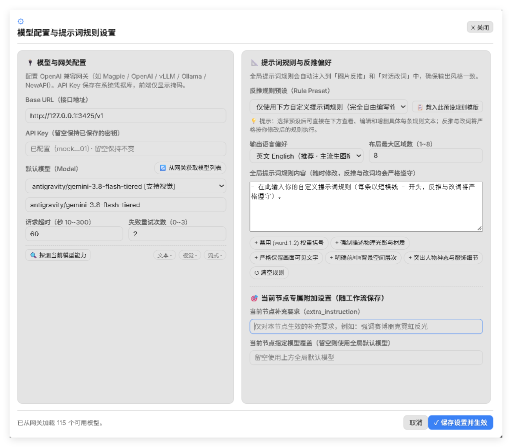

# ComfyUI AI Prompt Studio

<p align="center">
  <strong>ComfyUI 的多模态 AI 提示词工作台与智能反推节点</strong><br>
  多模态反推 · 空间区域排版画框 · 三格式输出（散文 / 布局 / Danbooru）· 结构化改词 · 零侵入全局侧边栏
</p>

<p align="center">
  
  
  
  
  
</p>

<p align="center">
  <a href="https://github.com/atattier/ComfyUI-AI-Prompt-Studio/releases/latest">
    
  </a>
  &nbsp;&nbsp;
  <a href="https://github.com/atattier/ComfyUI-AI-Prompt-Studio/releases/download/v1.0.2/ComfyUI-PromptStudio-v1.0.2.apk">
    
  </a>
</p>

---

## 🌟 核心亮点

- 🖼️ **富交互反推节点 (`AIPromptStudioCaption`)**：直接在 ComfyUI 画布中完成图像反推、多形态画框微调、提示词修改与参数输出。
- 🎯 **三格式输出与一键全开**：支持 **散文 (Prose/MOSS 规范)**、**空间排版 (Layout JSON)** 与 **Danbooru (标签体系)** 三种格式，点按「3格式全开」可同时启用 3 端口并行输出。
- 📐 **多形态空间布局画框**：支持**左翼挂载**、**右翼挂载**与**内嵌双栏**形态切换；支持自由拉框、缩放、移动、自适应深浅背景文字，并自带侧边栏专属「↩ 撤销」支持。
- 📏 **智能尺寸适配 (Width/Height)**：根据输入图像宽高比，自动匹配 MOSS 推荐的分辨率网格（16 整数倍、面积近 1M、每边 256~2048），直接作为 INT 尺寸连入 Latent / 出图节点。
- ⚙️ **统一模型网关与全局规则**：兼容任意 OpenAI 格式接口（Magpie / NewAPI / OneAPI / vLLM / Ollama 等）；支持 MOSS 官方散文/布局规范，并独创 **「★ 用户自定义要求」** 自动合并注入所有预设规则。
- ⚡ **零侵入侧边栏工作台**：自带独立的侧边栏面板，自动识别画布中任意文本节点，采用**结构化操作（replace/insert/append/delete）与块级 Diff 审阅机制**，绝不幻觉重写整段提示词，支持无限撤销与 SQLite 历史版本回溯。

---

## 📸 界面预览

| 节点富交互界面与改词动作条 | 多形态空间布局画框与撤销 | 网关配置与自定义提示词规则 |
|:---:|:---:|:---:|
|  |  |  |

---

## 📦 安装方法

### 方式一：通过 ComfyUI-Manager（推荐）
1. 在 ComfyUI 的 Manager 菜单中搜索 `ComfyUI-AI-Prompt-Studio`；
2. 点击 Install 安装并重启 ComfyUI。

### 方式二：Git Clone 手动安装
在你的 ComfyUI 根目录下的 `custom_nodes` 文件夹中执行：
```bash
cd custom_nodes
git clone https://github.com/atattier/ComfyUI-AI-Prompt-Studio.git
```
依赖极度轻量（仅依赖 ComfyUI 本身自带的 `aiohttp` 和 Python 标准库），无需安装复杂的外部编译包。

---

## 🚀 快速上手

### 1. 配置模型网关与 API 密钥
1. 点击节点顶栏的 **「⚙ 设置」** 按钮（或打开侧边栏工作台底部的设置）；
2. 填写模型服务网关信息：
   - **Base URL**：例如 `http://127.0.0.1:3425/v1`（本机 Magpie 网关）或 `https://api.openai.com/v1`；
   - **API Key**：你的接口密钥；
   - **默认模型 (Model)**：支持一键从网关拉取可用模型列表，并支持文本/视觉/流式能力探测；
3. 点击 **「保存设置并生效」**。

> 🔒 **安全承诺**：API Key 仅安全存储于本机操作系统凭据库（Windows Credential Manager / 受保护文件）和后端内存中；前端页面仅显示脱敏掩码，工作流 JSON、审计日志与 Git 仓库中**绝不写入**任何明文密钥。

---

### 2. 使用画布节点：AI 图像反推提示词 (`AIPromptStudioCaption`)

右键画布菜单 `添加节点 -> AI Prompt Studio -> AI 图像反推提示词`。

```
[LoadImage] ──(IMAGE)──→ [AI 图像反推提示词] ──┬─→ caption_prompt  (STRING) ──→ CLIP Text Encode
                           模式支持 1~3 全开:  ├─→ layout_prompt   (STRING) ──→ MOSSPromptBoard
                            ☑ 散文 (MOSS)       ├─→ danbooru_prompt (STRING) ──→ 标签负向/风格模型
                            ☑ 布局 (Layout)     ├─→ width           (INT)    ──→ 空白 Latent / 采样尺寸
                            ☑ Danbooru (Tags)   ├─→ height          (INT)    ──→ 空白 Latent / 采样尺寸
                                                └─→ negative_prompt (STRING) ──→ 负向 CLIP Text Encode
```

#### 端口与功能说明
| 输出端口 | 数据类型 | 说明 |
|---|---|---|
| `caption_prompt` | `STRING` | 自然语言散文提示词（严格遵守 MOSS 具象名词、光影物理规律、禁用废词规则） |
| `layout_prompt` | `STRING` | 空间区域排版 JSON（PromptBoard 兼容，包含 `summary` 与 `items[].bbox` 绝对像素坐标） |
| `danbooru_prompt` | `STRING` | 结构化英文逗号标签（发型、神态、服饰、构图、光影按优先级清晰排列） |
| `width` / `height` | `INT` | 依据图像比例自动匹配的 MOSS 标准输出分辨率（16 整数倍） |
| `negative_prompt` | `STRING` | 自动匹配当前风格的通用高质量负向提示词（去畸变、防画崩），一键连入负向节点 |

#### 节点常用操作
- **3格式全开**：顶栏点按一键切换开启/关闭 3 格式并行输出；
- **排版形态切换**：支持点按「左翼 / 右翼 / 内嵌」，画框既可折叠进节点，也可悬浮在节点两侧，不遮挡提示词；
- **选中框局部精修（重点升级）**：
  - 点击画框内任意区域框或标签胶囊，即弹出局部编辑抽屉；
  - 支持直接修改区域标签（角色、物体、文字、背景、特效、服饰）与细节描述；
  - 自带 **「改此区 ✦」**、**「✨ 扩写」**、**「🌐 译英」**，针对选定框进行精准局部 AI 润色；
  - 支持键盘快捷键：选框后按 `Delete` / `Backspace` 删框，`Esc` 取消选中，`Ctrl+Z` 撤销；
- **快捷改词条**：
  - `⚡ 反推`：重新读取图像并执行多模态反推；
  - `✨ 扩写`：丰富画面环境与氛围细节；
  - `🌐 译英`：一键翻译中文创意并符合模型生图逻辑；
  - `🎯 MOSS精炼`：自动剔除无意义虚词，强化构图与光影修饰；
  - `📋 复制`：一键复制当前输入框提示词到系统剪贴板；
  - `↩ 撤销`：撤销当前输入框编辑；
- **实时字数统计**：提示词输入框底部实时动态显示当前词数、标签数或空间区域数；
- **中文友好报错**：网络中断、API Key 失效、模型未找到或限额超限时，醒目给出精准中文修复提示；
- **对话改词**：在底部直接输入改词指令（如 `把白衬衫改成黑白赛车夹克`）并回车，模型将针对性调整；
- **随工作流缓存**：反推结果自动随工作流 JSON 保存，再次排队执行时只读缓存，绝不重复烧额度。

---

### 3. 使用全局侧边栏工作台（零侵入）

在 ComfyUI 右侧或左侧功能栏中点击 **「AI 提示词」** 图标即可唤出。

```
画布选中任意文本节点 ──→ 侧边栏自动绑定 ──→ 对话提修改/反推参考图 ──→ 块级 Diff 差异审阅 ──→ 应用并记录版本
```

- **严格防幻觉编辑**：模型以结构化操作提案（`replace` / `insert_after` / `delete` / `append`）输出修改，必须在当前文本中唯一匹配才允许应用，杜绝模型擅自删减用户提示词；
- **版本历史回溯**：每次写入均自动存入本地 SQLite，支持按节点控件独立回退历史版本与无限级撤销/重做。

---

## 📂 示例工作流

本项目在 [`examples/`](examples/) 目录中提供了完整的快速体验工作流：
- [`examples/workflow_caption_demo.json`](examples/workflow_caption_demo.json)：加载图像 ➔ AI 反推提示词 ➔ 散文/布局/Danbooru 同时输出的基础示例，直接拖入 ComfyUI 即可使用。

---

## 🛠️ 后端 API 路由

插件通过 ComfyUI 内置的 `aiohttp` 服务注册同源路由，无需额外端口或配置跨域（CORS）：

| 方法 | 路由 | 用途 |
|---|---|---|
| `GET` | `/ai_prompt_studio/health` | 服务存活探测 |
| `GET` | `/ai_prompt_studio/status` | 服务状态、公开配置（密钥仅掩码）与模型探测报告 |
| `POST` | `/ai_prompt_studio/config` | 保存网关地址、模型、超时与全局提示词规则配置 |
| `POST` | `/ai_prompt_studio/probe` | 探测指定模型文本/视觉/流式能力 |
| `POST` | `/ai_prompt_studio/chat` | 多轮对话流式 SSE 交互 |
| `POST` | `/ai_prompt_studio/edit` | 生成结构化编辑提案与校验 |
| `POST` | `/ai_prompt_studio/caption` | 多格式图像反推接口 |
| `POST` | `/ai_prompt_studio/caption_node` | 画布节点富交互反推后端（含 MOSS 尺寸算子与排版草稿） |
| `POST` | `/ai_prompt_studio/cloud_generate`| 云端生图/提示词扩展接口，返回完整节点载荷与推荐分辨率 |
| `GET/POST`| `/ai_prompt_studio/versions` | 提示词版本历史存取与回退 |

---

## ☁️ 云端生图与提示词扩展

无需在本地画布中拼接复杂节点链路，即可在侧边栏一键调用远程大模型扩写生图：

### 接口请求示例
```http
POST /ai_prompt_studio/cloud_generate
Content-Type: application/json

{
  "prompt": "赛博朋克雨夜街道中的机械少女",
  "width": 1024,
  "height": 1024,
  "mode": "caption"
}
```

- **参数说明**：
  - `prompt` (必填): 画面核心创意或描述；
  - `width` / `height` (可选，默认 1024): 期望尺寸，后端将自动规整为匹配模型的 16 整数倍；
  - `mode` (可选，默认 `"caption"`): 支持 `caption` (自然语言)、`layout` (排版分块) 与 `danbooru` (二次元标签)；
  - `model` (可选): 单次覆盖全局配置模型。
- **返回结果**：返回结构兼容的 `payload`，侧边栏点击可一键同步写入当前画布选中的文本节点并记录历史版本。

---

## 📱 移动端与 Android APK 支持

本项目自带原生 Android 独立移动端应用，专为大众创作者和移动办公设计：

- ☁️ **MOSS 官方生图 API 直连 (开箱即用)**：无需在手机或电脑运行 ComfyUI！支持直接配置 MOSS (MOSI) 官方出图 Key (`moss_api_key`)，直接调用 `https://api.mosi.cn/v1/images/generations` 云端生成高质量图像，并自动无损存入手机相册。
- 🎯 **MOSS-Image 全模型与尺寸矩阵**：支持 `moss-image-sft-1.0` 与 1:1、2:3、3:2、9:16、16:9、1:2 (1024x2048) 等全套官方推荐宽高比白名单。
- ✍️ **MOSS 散文提示词工坊**：集成针对 Qwen3.5 文本编码器量身打造的画风、构图、光影词库，支持离线直拼与 AI 散文扩写。
- 📷 **多模态识图反推**：手机拍照或相册选图后，一键反推高拟合度 MOSS 散文描述词或 Danbooru 动漫标签。

### 📥 快速下载
- **GitHub Release 最新版**：[下载 ComfyUI-PromptStudio-v1.0.2.apk](https://github.com/atattier/ComfyUI-AI-Prompt-Studio/releases/download/v1.0.2/ComfyUI-PromptStudio-v1.0.2.apk)

### 本地构建方式
- **Android Studio**：直接打开项目根目录下的 `android/` 目录，点按 Run 或 Build APK；
- **命令行构建**：`cd android && gradle assembleDebug`，生成 `app-debug.apk`。

---

## 🧪 开发与测试

本项目具备完善的自动化测试套件：

```bash
# 运行 Python 单元测试（覆盖配置、Diff 校验、布局计算、凭据保护与节点交互）
python -m unittest discover tests

# 运行 JavaScript 单元测试（覆盖 SSE 解析、撤销栈、SVG 画框、目标绑定与布局编辑器）
node --test tests_js/*.test.mjs
```

---

## 📄 许可证与开源合规

本项目采用 **[GPL-3.0 License](LICENSE)** 开源。
- 零侵入设计：完全通过 ComfyUI 公开扩展点（`WEB_DIRECTORY`、`PromptServer.routes`）注册；
- 独立轻量：不内嵌不可分发的专有权重，核心算法完全遵循开源生态规范。
